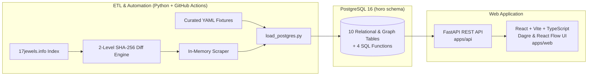

# CaliberGraph — Horological Caliber Lineage & Compatibility Engine

A full-stack decision-support and graph traversal platform indexing **1,051 watch movements across 171 manufacturers** to help watchmakers trace movement lineages, source discontinued replacement parts from donor movements, and calculate drop-in physical case/hand swaps.

---

## Key Features

- **Fast Fuzzy Catalog Search** — Debounced search across calibers, references, and normalized aliases (`pg_trgm` GIN trigram indexes in PostgreSQL) with brand, winding type, and source filters.
- **Interactive Movement Family Tree (Lineage Graph)** — Directed acyclic graph (`DERIVED_FROM`, `CLONE_OF`, `USES_EBAUCHE`) queried via PostgreSQL `WITH RECURSIVE` CTEs with cycle prevention and auto-laid out in the browser using **Dagre + React Flow**.
- **Donor Movement Scavenging Engine** — Maps brand-specific part numbers into shared physical equivalence bins (`part_class`) and ranks donor movements using a composite score:
  - **45%** Weighted Part Coverage
  - **25%** Weighted Jaccard Similarity
  - **30%** Market Accessibility (prioritizing affordable, modern donors over rare vintage calibers)
  - Supports live per-part slot filtering (e.g., *Balance Complete*, *Winding Stem*, *Mainspring*).
- **Drop-In Case & Hand Swap Calculator** — Evaluates sub-millimeter physical tolerances (diameter, height, stem height, crown position, and hand-hole diameters) to classify swaps (`direct_swap`, `minor_mod`, `case_mod`) and auto-generate watchmaker modification warnings.
- **Automated 2-Level Diffing ETL Pipeline** — In-memory scraping (`httpx` + `BeautifulSoup`) with two-level SHA-256 fingerprinting (`diff_engine.py`) and weekly GitHub Actions cron syncs, cutting redundant HTTP traffic by over 95%.
- **Resilient In-Memory Fallback** — FastAPI's `HorologyRepository` automatically falls back to curated YAML fixtures if PostgreSQL is unreachable.

---

## Architecture



---

## Tech Stack

| Layer | Technologies |
| :--- | :--- |
| **Frontend** | React 18, TypeScript, Vite, Tailwind CSS, React Flow, Dagre |
| **Backend** | Python 3.11+, FastAPI, Uvicorn, psycopg2 |
| **Database** | PostgreSQL 16 (`pg_trgm`, `JSONB`, Recursive CTEs, SQL Functions) |
| **ETL & Automation** | Python, `httpx`, BeautifulSoup4, PyYAML, GitHub Actions, Docker Compose |

---

## Project Structure

```text
watchmaker_help/
├── apps/
│   ├── api/                        # FastAPI backend & repository (PG + memory fallback)
│   │   ├── main.py                 # REST endpoints (/api/search, /lineage, /donors, /substitutes)
│   │   └── db.py                   # HorologyRepository
│   └── web/                        # React + Vite + TypeScript frontend
│       └── src/
│           ├── App.tsx             # Main workbench UI
│           ├── api.ts              # Typed API client
│           └── components/         # FamilyTreeTab, DonorPartsTab, CaseSwapTab, MovementNode
├── data/
│   ├── fixtures/                   # Hand-verified Swiss & Japanese movement/part YAMLs
│   └── processed/                  # Synced 17jewels JSON records, changelogs, & CSVs
├── etl/
│   ├── algorithms/                 # donor_matching.py, substitutes.py, diff_engine.py
│   ├── scrapers/                   # fetch_17jewels_index.py, extract_17jewels_urls.py, sync_17jewels_cron.py
│   ├── load_postgres.py            # Applies migration & upserts YAML + scraped data into PostgreSQL
│   └── run_pipeline.py             # Offline CSV algorithm test runner
├── packages/db/migrations/
│   └── 001_init_horo_schema.sql    # horo schema, 10 tables, GIN indexes, & 4 SQL functions
├── .github/workflows/
│   └── sync_movements_cron.yml     # Weekly scheduled movement sync workflow
├── docs/
│   ├── PROJECT_MASTER_GUIDE.md     # Deep-dive architecture, math, SQL, & deployment guide
│   └── FRONTEND_ARCHITECTURE.md    # Frontend component & state design
├── docker-compose.yml              # Local PostgreSQL 16 (port 5435 -> 5432)
└── requirements.txt                # Python dependencies
```

---

## Quickstart (Local Development)

### Option 1: Full Mode (PostgreSQL + All 1,051 Movements)

1. **Start PostgreSQL via Docker:**
   ```bash
   docker compose up -d
   ```

2. **Install Python dependencies & seed the database:**
   ```bash
   pip install -r requirements.txt
   python etl/load_postgres.py
   ```

3. **Start the FastAPI backend (Terminal 1):**
   ```bash
   uvicorn apps.api.main:app --reload --port 8000
   ```
   - Swagger API Docs: `http://localhost:8000/docs`
   - Health Check: `http://localhost:8000/api/health`

4. **Start the React frontend (Terminal 2):**
   ```bash
   cd apps/web
   npm install
   npm run dev
   ```
   - Open `http://localhost:5173` in your browser.

### Option 2: Quick Demo Mode (No Docker Required)

Skip Docker and start the backend and frontend directly—`apps/api/db.py` will automatically run in `memory_fallback` mode using the curated YAML fixtures:

```bash
# Terminal 1
uvicorn apps.api.main:app --reload --port 8000

# Terminal 2
cd apps/web && npm install && npm run dev
```

---

## API Endpoints

| Method | Endpoint | Description |
| :--- | :--- | :--- |
| `GET` | `/api/health` | Service status, active DB engine (`postgresql` or `memory_fallback`), and record counts |
| `GET` | `/api/manufacturers` | List all manufacturers ordered by caliber count |
| `GET` | `/api/search` | Search & filter calibers (`q`, `brand`, `winding`, `source`, `limit`, `offset`) |
| `GET` | `/api/calibers/{canonical_key}` | Full specifications, physical envelope, parts, and raw scraped table |
| `GET` | `/api/calibers/{canonical_key}/lineage` | Upstream & downstream family tree DAG (`nodes`, `edges`) |
| `GET` | `/api/calibers/{canonical_key}/donors` | Ranked donor movements with shared parts & optional `part_slot` filter |
| `GET` | `/api/calibers/{canonical_key}/substitutes` | Drop-in case/hand replacement candidates with tolerance diffs & warnings |

---

## Running the Incremental Scraper & Diff Engine

```bash
# Test the 2-level SHA-256 diff engine offline (simulated):
python etl/scrapers/sync_17jewels_cron.py --simulate-diff

# Scrape up to 5 Seiko movements on the fly in memory:
python etl/scrapers/sync_17jewels_cron.py --brand seiko --limit 5
```

---

## Cloud Deployment

The project is ready to deploy on free-tier cloud infrastructure:

1. **PostgreSQL:** Provision a database on [Neon](https://neon.tech) or [Supabase](https://supabase.com) and seed it:
   ```bash
   python etl/load_postgres.py --db-url "YOUR_POSTGRES_CONNECTION_STRING"
   ```
2. **Backend (FastAPI):** Deploy on [Render](https://render.com) or [Railway](https://railway.app) with:
   - **Build:** `pip install -r requirements.txt`
   - **Start:** `uvicorn apps.api.main:app --host 0.0.0.0 --port $PORT`
   - **Env:** `DATABASE_URL=<your-postgres-url>`
3. **Frontend (React/Vite):** Deploy `apps/web` on [Vercel](https://vercel.com) or [Netlify](https://netlify.com) with:
   - **Env:** `VITE_API_URL=https://<your-api-domain>/api`

---

## Documentation

- [Project Master Study Guide & Deployment Manual](docs/PROJECT_MASTER_GUIDE.md)
- [Frontend Architecture Guide](docs/FRONTEND_ARCHITECTURE.md)
